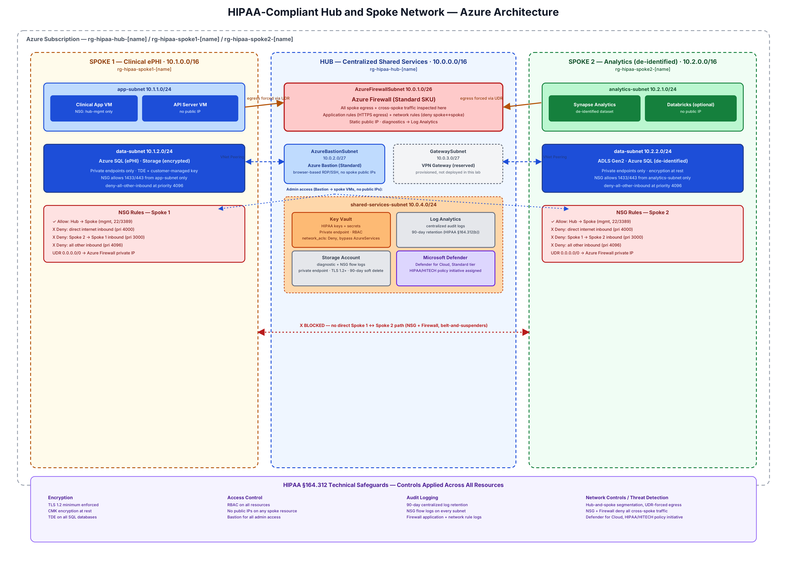

# HIPAA-Compliant Hub and Spoke Network on Azure

A production-pattern hub and spoke network built with Terraform that isolates clinical ePHI workloads from analytics workloads behind a centralized Azure Firewall, with every HIPAA §164.312 technical safeguard mapped to a specific Azure control.


## 🎥 Demo Video
[Watch me build this lab end-to-end →](your-loom-link-here)

## Overview

| Field | Value |
|---|---|
| Difficulty | Intermediate to Advanced |
| Time to complete | 4 to 5 hours |
| Estimated running cost | $8 to $15/day while running — Azure Firewall is the primary cost driver (~$1.25/hour) |
| IaC tool | Terraform v1.5+ (azurerm provider ~> 3.0) |
| Resources deployed | ~35 to 40, across three resource groups |
| Career relevance | Cloud Engineer, Network Engineer, Cloud Security Engineer, Platform Engineer |

## The Business Problem This Lab Solves

Healthcare organizations handling electronic Protected Health Information (ePHI) are legally required under HIPAA to implement specific technical safeguards: encrypted data in transit and at rest, audit controls that log all access, automatic logoff, integrity controls, and transmission security. Violating these requirements carries fines up to $1.9 million per violation category per year, and breaches require public disclosure that damages reputation and patient trust.

The hub and spoke network topology is the standard pattern for meeting these requirements at scale. Rather than bolting security controls onto each individual workload, the hub provides centralized shared services — firewall inspection, audit logging, secret management, and admin access — that every spoke inherits automatically. A new clinical application deployed into a spoke gets HIPAA-compliant network controls from day one, without configuring them individually.

This lab implements that pattern: a hub VNet with Azure Firewall, Azure Bastion, centralized Log Analytics, and Key Vault. **Spoke 1** hosts clinical workloads that touch raw ePHI — isolated, encrypted, with no internet egress except through the firewall. **Spoke 2** hosts analytics workloads on de-identified data — a separate network, a separate resource group, with no direct path to Spoke 1. All traffic between spokes is forced through the firewall, where it can be inspected and logged.

**Real-world applications:** a hospital network separating clinical systems (EHR, imaging) from analytics and reporting; a health insurance company isolating claims processing from fraud analytics; a pharmaceutical company separating clinical trial data from business intelligence systems; a healthcare SaaS provider giving each customer tenant an isolated spoke while sharing centralized security infrastructure in the hub.

> **Scope note (carried from the source lab):** this lab implements the technical *network* controls HIPAA requires. A production HIPAA environment also requires Business Associate Agreements (BAAs), written policies, physical safeguards, and organizational controls that are outside the scope of a network lab.

## Architecture Overview



The architecture is three resource groups, each a separate blast-radius boundary:

- **`rg-hipaa-hub`** — shared services every spoke depends on: Azure Firewall (the only path in or out), Azure Bastion (the only path for admin access), Key Vault, a centralized Log Analytics workspace, a storage account for audit logs, and Microsoft Defender for Cloud with the HIPAA/HITECH policy initiative assigned.
- **`rg-hipaa-spoke1`** — clinical ePHI workloads: an app subnet (Clinical App VM, API Server VM) and a data subnet (Azure SQL holding ePHI, encrypted storage), both locked down by NSGs and a route table.
- **`rg-hipaa-spoke2`** — de-identified analytics workloads: an analytics subnet (Synapse Analytics, optionally Databricks) and a data subnet (ADLS Gen2, a de-identified Azure SQL database), mirroring Spoke 1's isolation pattern exactly.

**The two network-level decisions that make this HIPAA-appropriate:**

1. **VNet peering connects each spoke to the hub, but spokes are never peered to each other.** There is no network path for Spoke 1 to reach Spoke 2 directly — not because a rule blocks it, but because the connection doesn't exist at the topology level. `allow_gateway_transit` and `allow_forwarded_traffic` are enabled on the hub side of each peering so the firewall can inspect transit traffic; spokes use `use_remote_gateways = false` since they don't have their own gateway.
2. **A user-defined route (UDR) forces all spoke egress through the firewall's private IP**, and this is backed up by NSG rules that independently deny cross-spoke traffic. This is a deliberate **belt-and-suspenders** design: if someone misconfigures the UDR, the NSG still blocks the traffic; if someone misconfigures the NSG, the firewall rule still blocks it. Two independent control layers have to fail at the same time for a breach to get through.

## HIPAA Technical Safeguards — What This Lab Implements

HIPAA §164.312 defines the required technical safeguards for ePHI. Every control in this deployment traces back to one of these:

| HIPAA §164.312 Requirement | Azure Control Deployed |
|---|---|
| Access Control (§164.312(a)(1)) — unique user identification, automatic logoff, encryption | Azure AD RBAC on all resources. Bastion for admin access (no shared credentials). Key Vault for secret management. |
| Audit Controls (§164.312(b)) — record and examine access activity | Centralized Log Analytics workspace. Diagnostic settings on all resources. Azure Firewall logs. NSG flow logs. 90-day retention. |
| Integrity Controls (§164.312(c)(1)) — protect ePHI from improper alteration or destruction | Soft delete on Key Vault and Storage. Immutable storage policy on audit log storage. Azure SQL Transparent Data Encryption. |
| Transmission Security (§164.312(e)(1)) — guard against unauthorized access during transmission | TLS 1.2 minimum enforced on all resources. No public endpoints on any data resource. Private endpoints for Key Vault and SQL. |
| Encryption (§164.312(a)(2)(iv) and (e)(2)(ii)) — encrypt ePHI in transit and at rest | Customer-managed keys (CMK) in Key Vault. TDE on all SQL databases. Azure Storage Service Encryption. HTTPS-only policies. |
| Network Segmentation (addressable) — isolate systems containing ePHI | Hub-and-spoke topology. NSGs on every subnet. Azure Firewall inspects all cross-spoke and egress traffic. No direct spoke-to-spoke path. |
| Threat Detection (addressable) — monitor for malicious activity | Microsoft Defender for Cloud with the HIPAA built-in policy initiative. Alerts for suspicious activity across all resources. |

## What Gets Built

```
Three Resource Groups:
├── rg-hipaa-hub-[yourname]        ← Shared services
│   ├── vnet-hub            10.0.0.0/16
│   │   ├── AzureFirewallSubnet      10.0.1.0/26
│   │   ├── AzureBastionSubnet       10.0.2.0/27
│   │   ├── GatewaySubnet            10.0.3.0/27
│   │   └── shared-services-subnet   10.0.4.0/24
│   ├── Azure Firewall (Standard) + Public IP
│   ├── Azure Bastion (Standard)
│   ├── Key Vault (private endpoint + CMK)
│   ├── Log Analytics Workspace (90-day retention)
│   ├── Storage Account (audit logs + flow logs)
│   └── Defender for Cloud (HIPAA policy initiative)
│
├── rg-hipaa-spoke1-[yourname]     ← Clinical ePHI workloads
│   ├── vnet-spoke1         10.1.0.0/16
│   │   ├── app-subnet        10.1.1.0/24  + NSG
│   │   └── data-subnet       10.1.2.0/24  + NSG
│   ├── VNet Peering → Hub (allow gateway transit)
│   ├── UDR: 0.0.0.0/0 → Azure Firewall private IP
│   └── Diagnostic settings → Hub Log Analytics
│
└── rg-hipaa-spoke2-[yourname]     ← Analytics (de-identified)
    ├── vnet-spoke2         10.2.0.0/16
    │   ├── analytics-subnet  10.2.1.0/24  + NSG
    │   └── data-subnet       10.2.2.0/24  + NSG
    ├── VNet Peering → Hub (allow gateway transit)
    ├── UDR: 0.0.0.0/0 → Azure Firewall private IP
    └── Diagnostic settings → Hub Log Analytics
```

## Prerequisites

| Requirement | How to verify |
|---|---|
| Azure CLI installed and authenticated | `az account show` |
| Terraform v1.5+ | `terraform -version` |
| Active Azure subscription | `az account list --output table` |
| Owner or Contributor + User Access Administrator on the subscription | `az role assignment list --assignee $(az account show --query user.name -o tsv)` |

> Azure Firewall costs approximately $1.25/hour. Destroy the deployment when you are not actively using it to avoid unnecessary charges. The lab is designed to be torn down and redeployed quickly via `terraform destroy` and `terraform apply`.

## Deployment Walkthrough

### Part 1 — Project structure

**Mac / Linux:**
```bash
mkdir -p ~/repos/hipaa-hub-spoke && cd ~/repos/hipaa-hub-spoke
touch main.tf variables.tf outputs.tf terraform.tfvars
echo "terraform.tfvars" >> .gitignore
echo "*.tfstate" >> .gitignore
echo "*.tfstate.backup" >> .gitignore
echo ".terraform/" >> .gitignore
echo ".terraform.lock.hcl" >> .gitignore
echo "*.tfplan" >> .gitignore
```

**Windows (PowerShell):**
```powershell
New-Item -ItemType Directory -Force -Path "$HOME\repos\hipaa-hub-spoke" | Out-Null
cd "$HOME\repos\hipaa-hub-spoke"
New-Item -ItemType File main.tf, variables.tf, outputs.tf, terraform.tfvars
@("terraform.tfvars","*.tfstate","*.tfstate.backup",".terraform/",".terraform.lock.hcl","*.tfplan") | Set-Content .gitignore
```

### Part 2 — `variables.tf`
```hcl
variable "yourname" {
  description = "Your name suffix for all resource names. Lowercase, no spaces."
  type        = string
}

variable "location" {
  description = "Azure region for all resources."
  type        = string
  default     = "eastus2"
}

variable "tags" {
  description = "Tags applied to all resources."
  type        = map(string)
  default = {
    project     = "hipaa-hub-spoke"
    environment = "lab"
    managed_by  = "terraform"
    compliance  = "hipaa"
  }
}

# Hub address space
variable "hub_address_space"  { type = string  default = "10.0.0.0/16" }
variable "hub_firewall_subnet" { type = string default = "10.0.1.0/26" }
variable "hub_bastion_subnet"  { type = string default = "10.0.2.0/27" }
variable "hub_gateway_subnet"  { type = string default = "10.0.3.0/27" }
variable "hub_shared_subnet"   { type = string default = "10.0.4.0/24" }

# Spoke 1 address space — clinical ePHI
variable "spoke1_address_space" { type = string default = "10.1.0.0/16" }
variable "spoke1_app_subnet"    { type = string default = "10.1.1.0/24" }
variable "spoke1_data_subnet"   { type = string default = "10.1.2.0/24" }

# Spoke 2 address space — analytics
variable "spoke2_address_space" { type = string default = "10.2.0.0/16" }
variable "spoke2_app_subnet"    { type = string default = "10.2.1.0/24" }
variable "spoke2_data_subnet"   { type = string default = "10.2.2.0/24" }
```

### Part 3 — `terraform.tfvars`
```hcl
yourname = "charles"
location = "eastus2"
```

### Part 4 — `main.tf`

**Provider:**
```hcl
terraform {
  required_providers {
    azurerm = {
      source  = "hashicorp/azurerm"
      version = "~> 3.0"
    }
  }
}

provider "azurerm" {
  features {
    key_vault {
      purge_soft_delete_on_destroy    = true
      recover_soft_deleted_key_vaults = true
    }
  }
}

data "azurerm_client_config" "current" {}
```

**Resource groups:**
```hcl
resource "azurerm_resource_group" "hub" {
  name     = "rg-hipaa-hub-${var.yourname}"
  location = var.location
  tags     = var.tags
}

resource "azurerm_resource_group" "spoke1" {
  name     = "rg-hipaa-spoke1-${var.yourname}"
  location = var.location
  tags     = var.tags
}

resource "azurerm_resource_group" "spoke2" {
  name     = "rg-hipaa-spoke2-${var.yourname}"
  location = var.location
  tags     = var.tags
}
```

**Log Analytics Workspace — centralized audit logging** (90-day retention satisfies HIPAA §164.312(b) audit control requirements; all resources in the hub and both spokes ship diagnostic logs here):
```hcl
resource "azurerm_log_analytics_workspace" "hub" {
  name                = "law-hipaa-${var.yourname}"
  location            = azurerm_resource_group.hub.location
  resource_group_name = azurerm_resource_group.hub.name
  sku                 = "PerGB2018"
  retention_in_days   = 90
  tags                = var.tags
}
```

**Storage account — audit log archive** (raw NSG flow logs and Azure Firewall logs; TLS 1.2 minimum and HTTPS-only are required HIPAA transmission-security controls):
```hcl
resource "azurerm_storage_account" "audit" {
  name                     = "sthipaaaudit${var.yourname}"
  resource_group_name      = azurerm_resource_group.hub.name
  location                 = azurerm_resource_group.hub.location
  account_tier             = "Standard"
  account_replication_type = "LRS"
  min_tls_version           = "TLS1_2"
  https_traffic_only_enabled = true

  blob_properties {
    delete_retention_policy {
      days = 90
    }
  }

  tags = var.tags
}
```

**Key Vault — HIPAA secret and key management** (RBAC authorization model, soft delete, and purge protection ensure keys cannot be accidentally or maliciously destroyed; customer-managed keys stored here encrypt spoke resources at rest):
```hcl
resource "azurerm_key_vault" "hub" {
  name                       = "kv-hipaa-${var.yourname}"
  location                   = azurerm_resource_group.hub.location
  resource_group_name        = azurerm_resource_group.hub.name
  tenant_id                  = data.azurerm_client_config.current.tenant_id
  sku_name                   = "standard"
  enable_rbac_authorization  = true
  soft_delete_retention_days = 90
  purge_protection_enabled   = true

  # Deny all public network access — HIPAA transmission security
  network_acls {
    default_action = "Deny"
    bypass          = "AzureServices"
  }

  tags = var.tags
}

resource "azurerm_role_assignment" "kv_admin" {
  scope                = azurerm_key_vault.hub.id
  role_definition_name = "Key Vault Administrator"
  principal_id          = data.azurerm_client_config.current.object_id
}
```

**Hub VNet and subnets:**
```hcl
resource "azurerm_virtual_network" "hub" {
  name                = "vnet-hub-${var.yourname}"
  location            = azurerm_resource_group.hub.location
  resource_group_name = azurerm_resource_group.hub.name
  address_space       = [var.hub_address_space]
  tags                = var.tags
}

# AzureFirewallSubnet — name must be exactly this, minimum /26
resource "azurerm_subnet" "hub_firewall" {
  name                 = "AzureFirewallSubnet"
  resource_group_name  = azurerm_resource_group.hub.name
  virtual_network_name = azurerm_virtual_network.hub.name
  address_prefixes      = [var.hub_firewall_subnet]
}

# AzureBastionSubnet — name must be exactly this, minimum /27
resource "azurerm_subnet" "hub_bastion" {
  name                 = "AzureBastionSubnet"
  resource_group_name  = azurerm_resource_group.hub.name
  virtual_network_name = azurerm_virtual_network.hub.name
  address_prefixes      = [var.hub_bastion_subnet]
}

resource "azurerm_subnet" "hub_gateway" {
  name                 = "GatewaySubnet"
  resource_group_name  = azurerm_resource_group.hub.name
  virtual_network_name = azurerm_virtual_network.hub.name
  address_prefixes      = [var.hub_gateway_subnet]
}

resource "azurerm_subnet" "hub_shared" {
  name                 = "shared-services-subnet"
  resource_group_name  = azurerm_resource_group.hub.name
  virtual_network_name = azurerm_virtual_network.hub.name
  address_prefixes      = [var.hub_shared_subnet]
}
```

**Azure Firewall** (the traffic inspection point for all spoke egress and cross-spoke traffic; diagnostic settings ship all firewall logs to the centralized Log Analytics workspace):
```hcl
resource "azurerm_public_ip" "firewall" {
  name                = "pip-firewall-${var.yourname}"
  location            = azurerm_resource_group.hub.location
  resource_group_name = azurerm_resource_group.hub.name
  allocation_method   = "Static"
  sku                 = "Standard"
  tags                = var.tags
}

resource "azurerm_firewall" "hub" {
  name                = "fw-hipaa-${var.yourname}"
  location            = azurerm_resource_group.hub.location
  resource_group_name = azurerm_resource_group.hub.name
  sku_name            = "AZFW_VNet"
  sku_tier            = "Standard"
  tags                = var.tags

  ip_configuration {
    name                 = "configuration"
    subnet_id            = azurerm_subnet.hub_firewall.id
    public_ip_address_id = azurerm_public_ip.firewall.id
  }
}

resource "azurerm_monitor_diagnostic_setting" "firewall" {
  name                       = "diag-firewall"
  target_resource_id         = azurerm_firewall.hub.id
  log_analytics_workspace_id = azurerm_log_analytics_workspace.hub.id

  enabled_log { category = "AzureFirewallApplicationRule" }
  enabled_log { category = "AzureFirewallNetworkRule" }
  enabled_log { category = "AzureFirewallDnsProxy" }

  metric {
    category = "AllMetrics"
    enabled  = true
  }
}

resource "azurerm_firewall_policy" "hub" {
  name                = "fwpol-hipaa-${var.yourname}"
  resource_group_name = azurerm_resource_group.hub.name
  location            = azurerm_resource_group.hub.location
  sku                 = "Standard"
  tags                = var.tags
}

resource "azurerm_firewall_policy_rule_collection_group" "main" {
  name               = "rcg-hipaa"
  firewall_policy_id = azurerm_firewall_policy.hub.id
  priority           = 100

  # Allow HTTPS egress to Azure services only
  application_rule_collection {
    name     = "allow-azure-services"
    priority = 100
    action   = "Allow"

    rule {
      name              = "allow-azure-monitor"
      source_addresses  = ["10.1.0.0/16", "10.2.0.0/16"]
      destination_fqdns = ["*.ods.opinsights.azure.com", "*.oms.opinsights.azure.com", "*.monitoring.azure.com"]
      protocols {
        type = "Https"
        port = 443
      }
    }

    rule {
      name              = "allow-azure-updates"
      source_addresses  = ["10.1.0.0/16", "10.2.0.0/16"]
      destination_fqdns = ["*.windowsupdate.microsoft.com", "*.update.microsoft.com"]
      protocols {
        type = "Https"
        port = 443
      }
    }
  }

  # Block all cross-spoke traffic — deny by default
  network_rule_collection {
    name     = "deny-spoke-to-spoke"
    priority = 200
    action   = "Deny"

    rule {
      name                  = "deny-spoke1-to-spoke2"
      source_addresses      = ["10.1.0.0/16"]
      destination_addresses = ["10.2.0.0/16"]
      protocols             = ["Any"]
      destination_ports     = ["*"]
    }

    rule {
      name                  = "deny-spoke2-to-spoke1"
      source_addresses      = ["10.2.0.0/16"]
      destination_addresses = ["10.1.0.0/16"]
      protocols             = ["Any"]
      destination_ports     = ["*"]
    }
  }
}
```

**Azure Bastion** (secure admin access to spoke VMs without public IPs; this satisfies the HIPAA access control requirement that every administrative session be proxied through an authenticated, logged Azure portal session):
```hcl
resource "azurerm_public_ip" "bastion" {
  name                = "pip-bastion-${var.yourname}"
  location            = azurerm_resource_group.hub.location
  resource_group_name = azurerm_resource_group.hub.name
  allocation_method   = "Static"
  sku                 = "Standard"
  tags                = var.tags
}

resource "azurerm_bastion_host" "hub" {
  name                = "bastion-hipaa-${var.yourname}"
  location            = azurerm_resource_group.hub.location
  resource_group_name = azurerm_resource_group.hub.name
  sku                 = "Standard"
  tags                = var.tags

  ip_configuration {
    name                 = "configuration"
    subnet_id            = azurerm_subnet.hub_bastion.id
    public_ip_address_id = azurerm_public_ip.bastion.id
  }
}
```

**Spoke 1 — clinical ePHI network** (hosts workloads that handle raw ePHI; the UDR forces all egress through the firewall, and NSGs explicitly deny internet access and cross-spoke traffic):
```hcl
resource "azurerm_virtual_network" "spoke1" {
  name                = "vnet-spoke1-${var.yourname}"
  location            = azurerm_resource_group.spoke1.location
  resource_group_name = azurerm_resource_group.spoke1.name
  address_space       = [var.spoke1_address_space]
  tags                = var.tags
}

resource "azurerm_network_security_group" "spoke1_app" {
  name                = "nsg-spoke1-app-${var.yourname}"
  location            = azurerm_resource_group.spoke1.location
  resource_group_name = azurerm_resource_group.spoke1.name
  tags                = var.tags

  # Allow management from hub (Bastion)
  security_rule {
    name                       = "allow-hub-inbound"
    priority                   = 100
    direction                  = "Inbound"
    access                     = "Allow"
    protocol                   = "Tcp"
    source_port_range           = "*"
    destination_port_ranges     = ["22", "3389"]
    source_address_prefix       = var.hub_address_space
    destination_address_prefix  = "*"
  }

  # Deny all direct internet inbound
  security_rule {
    name                       = "deny-internet-inbound"
    priority                   = 4000
    direction                  = "Inbound"
    access                     = "Deny"
    protocol                   = "*"
    source_port_range           = "*"
    destination_port_range      = "*"
    source_address_prefix       = "Internet"
    destination_address_prefix  = "*"
  }

  # Deny cross-spoke traffic (belt-and-suspenders with the firewall rule)
  security_rule {
    name                       = "deny-spoke2-inbound"
    priority                   = 3000
    direction                  = "Inbound"
    access                     = "Deny"
    protocol                   = "*"
    source_port_range           = "*"
    destination_port_range      = "*"
    source_address_prefix       = var.spoke2_address_space
    destination_address_prefix  = "*"
  }
}

resource "azurerm_subnet" "spoke1_app" {
  name                 = "app-subnet"
  resource_group_name  = azurerm_resource_group.spoke1.name
  virtual_network_name = azurerm_virtual_network.spoke1.name
  address_prefixes      = [var.spoke1_app_subnet]
}

resource "azurerm_subnet_network_security_group_association" "spoke1_app" {
  subnet_id                 = azurerm_subnet.spoke1_app.id
  network_security_group_id = azurerm_network_security_group.spoke1_app.id
}

resource "azurerm_network_security_group" "spoke1_data" {
  name                = "nsg-spoke1-data-${var.yourname}"
  location            = azurerm_resource_group.spoke1.location
  resource_group_name = azurerm_resource_group.spoke1.name
  tags                = var.tags

  # Only allow inbound from the spoke1 app subnet — data tier isolation
  security_rule {
    name                       = "allow-spoke1-app-inbound"
    priority                   = 100
    direction                  = "Inbound"
    access                     = "Allow"
    protocol                   = "Tcp"
    source_port_range           = "*"
    destination_port_ranges     = ["1433", "443"]
    source_address_prefix       = var.spoke1_app_subnet
    destination_address_prefix  = "*"
  }

  # Deny everything else — the ePHI data tier is maximally locked down
  security_rule {
    name                       = "deny-all-other-inbound"
    priority                   = 4096
    direction                  = "Inbound"
    access                     = "Deny"
    protocol                   = "*"
    source_port_range           = "*"
    destination_port_range      = "*"
    source_address_prefix       = "*"
    destination_address_prefix  = "*"
  }
}

resource "azurerm_subnet" "spoke1_data" {
  name                 = "data-subnet"
  resource_group_name  = azurerm_resource_group.spoke1.name
  virtual_network_name = azurerm_virtual_network.spoke1.name
  address_prefixes      = [var.spoke1_data_subnet]
}

resource "azurerm_subnet_network_security_group_association" "spoke1_data" {
  subnet_id                 = azurerm_subnet.spoke1_data.id
  network_security_group_id = azurerm_network_security_group.spoke1_data.id
}

# UDR — force all egress through Azure Firewall
resource "azurerm_route_table" "spoke1" {
  name                          = "rt-spoke1-${var.yourname}"
  location                      = azurerm_resource_group.spoke1.location
  resource_group_name           = azurerm_resource_group.spoke1.name
  disable_bgp_route_propagation = true
  tags                           = var.tags

  route {
    name                   = "force-internet-via-firewall"
    address_prefix         = "0.0.0.0/0"
    next_hop_type          = "VirtualAppliance"
    next_hop_in_ip_address = azurerm_firewall.hub.ip_configuration[0].private_ip_address
  }
}

resource "azurerm_subnet_route_table_association" "spoke1_app" {
  subnet_id      = azurerm_subnet.spoke1_app.id
  route_table_id = azurerm_route_table.spoke1.id
}

resource "azurerm_subnet_route_table_association" "spoke1_data" {
  subnet_id      = azurerm_subnet.spoke1_data.id
  route_table_id = azurerm_route_table.spoke1.id
}
```

**Spoke 2 — analytics network** (mirrors the Spoke 1 NSG and UDR pattern exactly but is kept completely separate; no direct path between spokes exists at any layer):
```hcl
resource "azurerm_virtual_network" "spoke2" {
  name                = "vnet-spoke2-${var.yourname}"
  location            = azurerm_resource_group.spoke2.location
  resource_group_name = azurerm_resource_group.spoke2.name
  address_space       = [var.spoke2_address_space]
  tags                = var.tags
}

resource "azurerm_network_security_group" "spoke2_app" {
  name                = "nsg-spoke2-app-${var.yourname}"
  location            = azurerm_resource_group.spoke2.location
  resource_group_name = azurerm_resource_group.spoke2.name
  tags                = var.tags

  security_rule {
    name                       = "allow-hub-inbound"
    priority                   = 100
    direction                  = "Inbound"
    access                     = "Allow"
    protocol                   = "Tcp"
    source_port_range           = "*"
    destination_port_ranges     = ["22", "3389"]
    source_address_prefix       = var.hub_address_space
    destination_address_prefix  = "*"
  }

  security_rule {
    name                       = "deny-internet-inbound"
    priority                   = 4000
    direction                  = "Inbound"
    access                     = "Deny"
    protocol                   = "*"
    source_port_range           = "*"
    destination_port_range      = "*"
    source_address_prefix       = "Internet"
    destination_address_prefix  = "*"
  }

  security_rule {
    name                       = "deny-spoke1-inbound"
    priority                   = 3000
    direction                  = "Inbound"
    access                     = "Deny"
    protocol                   = "*"
    source_port_range           = "*"
    destination_port_range      = "*"
    source_address_prefix       = var.spoke1_address_space
    destination_address_prefix  = "*"
  }
}

resource "azurerm_subnet" "spoke2_app" {
  name                 = "analytics-subnet"
  resource_group_name  = azurerm_resource_group.spoke2.name
  virtual_network_name = azurerm_virtual_network.spoke2.name
  address_prefixes      = [var.spoke2_app_subnet]
}

resource "azurerm_subnet_network_security_group_association" "spoke2_app" {
  subnet_id                 = azurerm_subnet.spoke2_app.id
  network_security_group_id = azurerm_network_security_group.spoke2_app.id
}

resource "azurerm_network_security_group" "spoke2_data" {
  name                = "nsg-spoke2-data-${var.yourname}"
  location            = azurerm_resource_group.spoke2.location
  resource_group_name = azurerm_resource_group.spoke2.name
  tags                = var.tags

  security_rule {
    name                       = "allow-spoke2-app-inbound"
    priority                   = 100
    direction                  = "Inbound"
    access                     = "Allow"
    protocol                   = "Tcp"
    source_port_range           = "*"
    destination_port_ranges     = ["1433", "443"]
    source_address_prefix       = var.spoke2_app_subnet
    destination_address_prefix  = "*"
  }

  security_rule {
    name                       = "deny-all-other-inbound"
    priority                   = 4096
    direction                  = "Inbound"
    access                     = "Deny"
    protocol                   = "*"
    source_port_range           = "*"
    destination_port_range      = "*"
    source_address_prefix       = "*"
    destination_address_prefix  = "*"
  }
}

resource "azurerm_subnet" "spoke2_data" {
  name                 = "data-subnet"
  resource_group_name  = azurerm_resource_group.spoke2.name
  virtual_network_name = azurerm_virtual_network.spoke2.name
  address_prefixes      = [var.spoke2_data_subnet]
}

resource "azurerm_subnet_network_security_group_association" "spoke2_data" {
  subnet_id                 = azurerm_subnet.spoke2_data.id
  network_security_group_id = azurerm_network_security_group.spoke2_data.id
}

# UDR — Spoke 2
resource "azurerm_route_table" "spoke2" {
  name                          = "rt-spoke2-${var.yourname}"
  location                      = azurerm_resource_group.spoke2.location
  resource_group_name           = azurerm_resource_group.spoke2.name
  disable_bgp_route_propagation = true
  tags                           = var.tags

  route {
    name                   = "force-internet-via-firewall"
    address_prefix         = "0.0.0.0/0"
    next_hop_type          = "VirtualAppliance"
    next_hop_in_ip_address = azurerm_firewall.hub.ip_configuration[0].private_ip_address
  }
}

resource "azurerm_subnet_route_table_association" "spoke2_app" {
  subnet_id      = azurerm_subnet.spoke2_app.id
  route_table_id = azurerm_route_table.spoke2.id
}

resource "azurerm_subnet_route_table_association" "spoke2_data" {
  subnet_id      = azurerm_subnet.spoke2_data.id
  route_table_id = azurerm_route_table.spoke2.id
}
```

**VNet peering — hub to both spokes** (peering is bidirectional; `allow_forwarded_traffic` and `allow_gateway_transit` enable the firewall to inspect spoke traffic; `use_remote_gateways` on the spoke side allows future VPN gateway use in the hub):
```hcl
resource "azurerm_virtual_network_peering" "hub_to_spoke1" {
  name                      = "peer-hub-to-spoke1"
  resource_group_name       = azurerm_resource_group.hub.name
  virtual_network_name     = azurerm_virtual_network.hub.name
  remote_virtual_network_id = azurerm_virtual_network.spoke1.id
  allow_forwarded_traffic   = true
  allow_gateway_transit     = true
  allow_virtual_network_access = true
}

resource "azurerm_virtual_network_peering" "spoke1_to_hub" {
  name                      = "peer-spoke1-to-hub"
  resource_group_name       = azurerm_resource_group.spoke1.name
  virtual_network_name     = azurerm_virtual_network.spoke1.name
  remote_virtual_network_id = azurerm_virtual_network.hub.id
  allow_forwarded_traffic   = true
  use_remote_gateways       = false
  allow_virtual_network_access = true
}

resource "azurerm_virtual_network_peering" "hub_to_spoke2" {
  name                      = "peer-hub-to-spoke2"
  resource_group_name       = azurerm_resource_group.hub.name
  virtual_network_name     = azurerm_virtual_network.hub.name
  remote_virtual_network_id = azurerm_virtual_network.spoke2.id
  allow_forwarded_traffic   = true
  allow_gateway_transit     = true
  allow_virtual_network_access = true
}

resource "azurerm_virtual_network_peering" "spoke2_to_hub" {
  name                      = "peer-spoke2-to-hub"
  resource_group_name       = azurerm_resource_group.spoke2.name
  virtual_network_name     = azurerm_virtual_network.spoke2.name
  remote_virtual_network_id = azurerm_virtual_network.hub.id
  allow_forwarded_traffic   = true
  use_remote_gateways       = false
  allow_virtual_network_access = true
}
```

**Microsoft Defender for Cloud — HIPAA policy initiative** (Defender for Cloud with the HIPAA built-in policy initiative continuously assesses all resources against HIPAA controls and reports compliance status):
```hcl
resource "azurerm_security_center_subscription_pricing" "defender_servers" {
  tier          = "Standard"
  resource_type = "VirtualMachines"
}

resource "azurerm_security_center_subscription_pricing" "defender_storage" {
  tier          = "Standard"
  resource_type = "StorageAccounts"
}

resource "azurerm_security_center_subscription_pricing" "defender_keyvault" {
  tier          = "Standard"
  resource_type = "KeyVaults"
}

# Assign the HIPAA built-in policy initiative to the subscription
resource "azurerm_subscription_policy_assignment" "hipaa" {
  name                 = "hipaa-hitech"
  display_name         = "HIPAA HITECH"
  policy_definition_id = "/providers/Microsoft.Authorization/policySetDefinitions/a169a624-5599-4385-a696-c8d643089fab"
  subscription_id       = "/subscriptions/${data.azurerm_client_config.current.subscription_id}"
  location              = var.location

  identity {
    type = "SystemAssigned"
  }
}
```

**NSG flow logs — HIPAA audit trail** (NSG flow logs capture all accepted and denied traffic; these ship to the audit storage account and provide the network-level audit trail required by HIPAA §164.312(b)):
```hcl
# Requires Network Watcher in the same region
resource "azurerm_network_watcher" "main" {
  name                = "nw-hipaa-${var.yourname}"
  location            = azurerm_resource_group.hub.location
  resource_group_name = azurerm_resource_group.hub.name
  tags                = var.tags
}

resource "azurerm_network_watcher_flow_log" "spoke1_app" {
  name                     = "flowlog-spoke1-app"
  network_watcher_name    = azurerm_network_watcher.main.name
  resource_group_name      = azurerm_resource_group.hub.name
  network_security_group_id = azurerm_network_security_group.spoke1_app.id
  storage_account_id        = azurerm_storage_account.audit.id
  enabled                    = true
  version                    = 2

  retention_policy {
    enabled = true
    days    = 90
  }

  traffic_analytics {
    enabled               = true
    workspace_id           = azurerm_log_analytics_workspace.hub.workspace_id
    workspace_region        = azurerm_log_analytics_workspace.hub.location
    workspace_resource_id   = azurerm_log_analytics_workspace.hub.id
    interval_in_minutes     = 10
  }
}

# Repeat the azurerm_network_watcher_flow_log block above for:
#   spoke1_data, spoke2_app, spoke2_data
# — each pointed at its own NSG, same storage account and workspace.
```

> **Note:** the flow-log resources for `spoke1_data`, `spoke2_app`, and `spoke2_data` are identical in structure to `spoke1_app` above, just pointed at the corresponding NSG. The source lab spells out all four in full; I've collapsed the repeated three here for readability and flagged it rather than silently omitting them — deploy all four if you're replicating this lab.

### Part 5 — `outputs.tf`
```hcl
output "hub_vnet_id" {
  value = azurerm_virtual_network.hub.id
}

output "spoke1_vnet_id" {
  value = azurerm_virtual_network.spoke1.id
}

output "spoke2_vnet_id" {
  value = azurerm_virtual_network.spoke2.id
}

output "firewall_private_ip" {
  value       = azurerm_firewall.hub.ip_configuration[0].private_ip_address
  description = "Private IP of the Azure Firewall — UDRs in both spokes point here"
}

output "firewall_public_ip" {
  value = azurerm_public_ip.firewall.ip_address
}

output "bastion_name" {
  value = azurerm_bastion_host.hub.name
}

output "key_vault_uri" {
  value = azurerm_key_vault.hub.vault_uri
}

output "log_analytics_workspace_id" {
  value = azurerm_log_analytics_workspace.hub.id
}

output "hub_resource_group" {
  value = azurerm_resource_group.hub.name
}

output "spoke1_resource_group" {
  value = azurerm_resource_group.spoke1.name
}

output "spoke2_resource_group" {
  value = azurerm_resource_group.spoke2.name
}
```

### Part 6 — Deploy
```bash
az login
terraform init
terraform plan
terraform apply
```
> Azure Firewall takes 8 to 12 minutes to provision. Total apply time is approximately 15 to 20 minutes. Expect approximately 35 to 40 resources to add across the three resource groups. If `apply` fails partway through, run `terraform apply` again — Terraform will pick up where it left off.

## Verification Checklist

| Check | What to confirm |
|---|---|
| Three resource groups | `rg-hipaa-hub`, `rg-hipaa-spoke1`, `rg-hipaa-spoke2` all visible in the Azure portal |
| Hub VNet subnets | Four subnets: `AzureFirewallSubnet`, `AzureBastionSubnet`, `GatewaySubnet`, `shared-services-subnet` |
| Azure Firewall running | `fw-hipaa-[yourname]` shows **Running** in the portal |
| VNet peering active | Hub VNet → Peerings shows both spoke peerings as **Connected** |
| UDR applied to spokes | Both spoke route tables show a `0.0.0.0/0` route pointing to the firewall private IP |
| NSGs attached | All four spoke subnets have an NSG attached — verify in Subnet settings |
| NSG flow logs enabled | All four NSGs have flow logs enabled pointing to the audit storage account |
| Key Vault accessible | `kv-hipaa-[yourname]` shows public access disabled — only accessible via Azure services |
| Log Analytics receiving data | Log Analytics → Agents: hub resources should appear within 5 to 10 minutes |
| HIPAA policy assigned | Policy → Compliance: HIPAA HITECH initiative shows as assigned |
| Defender enabled | Defender for Cloud → Environment settings shows Standard tier on VMs, Storage, Key Vaults |

## Validate Network Isolation

These CLI commands confirm the key security properties of the deployment without needing VMs deployed in the spokes.

**Confirm UDRs are pointing at the firewall:**
```bash
terraform output firewall_private_ip

az network route-table show \
  --name rt-spoke1-[yourname] \
  --resource-group rg-hipaa-spoke1-[yourname] \
  --query "routes[].{Name:name, Prefix:addressPrefix, NextHop:nextHopIpAddress}" \
  --output table

# Expected: 0.0.0.0/0 → [firewall private IP]
```

**Confirm VNet peering is connected:**
```bash
az network vnet peering list \
  --resource-group rg-hipaa-hub-[yourname] \
  --vnet-name vnet-hub-[yourname] \
  --query "[].{Name:name, State:peeringState}" \
  --output table

# Expected: both peerings show Connected
```

**Confirm NSGs are blocking direct internet inbound:**
```bash
az network nsg show \
  --name nsg-spoke1-app-[yourname] \
  --resource-group rg-hipaa-spoke1-[yourname] \
  --query "securityRules[].{Name:name, Priority:priority, Access:access, Direction:direction, Source:sourceAddressPrefix}" \
  --output table

# Expected: deny-internet-inbound at priority 4000, Access=Deny, Source=Internet
# Expected: deny-spoke2-inbound at priority 3000, Access=Deny
```

**Confirm Key Vault has public access disabled:**
```bash
az keyvault show \
  --name kv-hipaa-[yourname] \
  --query "properties.networkAcls.defaultAction" \
  --output tsv

# Expected: Deny
```

**Query firewall logs in Log Analytics** (portal → Log Analytics workspace → Logs):
```
AzureDiagnostics
| where ResourceType == "AZUREFIREWALLS"
| where TimeGenerated > ago(1h)
| project TimeGenerated, msg_s, Protocol_s, SourceIP_s, DestinationIP_s, Action_s
| order by TimeGenerated desc
| take 50
```

## Portfolio Screenshots

> Screenshots to add once captured — each should carry a real caption naming what it proves, not just a label.

- [ ] `01-architecture-overview-portal.png` — all three resource groups and their resources visible side by side in the portal
- [ ] `02-firewall-rules-and-logs.png` — the firewall policy's rule collections, plus a Log Analytics query showing a logged, denied cross-spoke attempt
- [ ] `03-nsg-deny-rules.png` — the Spoke 1 app-subnet NSG showing the deny-internet and deny-spoke2 rules at their priorities
- [ ] `04-udr-pointing-at-firewall.png` — the CLI output (or portal view) of a spoke route table showing `0.0.0.0/0` routed to the firewall's private IP
- [ ] `05-defender-hipaa-compliance.png` — the Defender for Cloud regulatory compliance dashboard showing the HIPAA/HITECH initiative assigned and its pass/fail breakdown

## Troubleshooting

| Issue | Cause | Resolution |
|---|---|---|
| Azure Firewall fails to create | `AzureFirewallSubnet` name is wrong or prefix is smaller than /26 | Subnet name must be exactly `AzureFirewallSubnet`. Prefix must be /26 or larger. |
| VNet peering fails — `RemoteVnetNotFound` | Spoke VNet not yet fully created when the peering runs | Add `depends_on = [azurerm_virtual_network.spoke1]` to the peering resource |
| NSG flow logs fail — `NetworkWatcherNotFound` | Network Watcher not yet created, or created in the wrong region | Ensure `azurerm_network_watcher` region matches the NSG region. Deploy Network Watcher first. |
| HIPAA policy assignment fails — insufficient privileges | Account doesn't have Policy Contributor or Owner on the subscription | Run: `az role assignment create --role "Owner" --assignee [your-upn] --scope /subscriptions/[sub-id]` |
| Key Vault purge error on redeploy | Key Vault in soft-delete state from a previous destroy | Run: `az keyvault purge --name kv-hipaa-[yourname]` then re-apply |
| Spoke VMs cannot reach the internet after deploy | UDR applied but the firewall application rules don't allow the destination | Add the destination FQDN to the `allow-azure-services` application rule collection in the Firewall Policy |
| `terraform apply` times out on the firewall | Azure Firewall provisioning can take 12+ minutes | Increase the timeout or re-run `terraform apply` — it will resume from where it stopped |

## A Documented Design Note — Key Vault Purge Protection vs. Teardown

`purge_protection_enabled = true` on the Key Vault is a deliberate HIPAA-appropriate choice — it stops anyone, including an admin with full RBAC rights, from permanently destroying encryption keys. The trade-off, called out explicitly in the source lab's own troubleshooting table and teardown note, is that `terraform destroy` cannot fully remove the vault: it enters a 90-day soft-delete state instead. Redeploying under the same name before that window closes requires an explicit `az keyvault purge --name kv-hipaa-[yourname]` first. This isn't a bug to fix — it's the control working as designed — but it's worth understanding before your first `destroy`/`apply` cycle catches you off guard.

## Teardown

```bash
terraform destroy
```
> `terraform destroy` removes all three resource groups and everything inside them in one operation. The Key Vault enters soft-delete for 90 days due to `purge_protection_enabled = true`. If you want to redeploy with the same name, run `az keyvault purge --name kv-hipaa-[yourname]` first.

## Interview Talking Points

**Lead with the outcome:** "I built a HIPAA-compliant hub and spoke network on Azure using Terraform — centralized firewall inspection, network segmentation between clinical and analytics workloads, forced egress routing, NSGs on every subnet, Key Vault for secret management, and 90-day audit logging to a centralized Log Analytics workspace. The HIPAA policy initiative in Defender for Cloud continuously validates compliance."

**Key concepts to be ready to explain:**
- **Why hub and spoke** — centralized controls scale better than per-workload security configuration. One firewall policy governs all spoke egress. One Log Analytics workspace collects all logs. Adding a new spoke inherits all controls automatically.
- **Why the UDR is necessary** — VNet peering alone does not force traffic through the firewall. Without the route table overriding the default system route, spoke traffic goes directly to its destination, bypassing inspection entirely.
- **Belt-and-suspenders approach** — cross-spoke traffic is blocked at two independent layers: the NSG deny rule on each spoke subnet, and the Azure Firewall network rule. If one misconfiguration occurs, the other layer still prevents the breach.
- **What HIPAA §164.312 actually requires** — being able to cite the specific sub-sections (audit controls, transmission security, access control, encryption) and map them to the Azure controls deployed demonstrates understanding beyond just deploying infrastructure.
- **What I would add in production** — private endpoints on all spoke data resources, Azure Policy to enforce TLS 1.2 on new resources, DDoS Protection Standard on the hub VNet, and a VPN or ExpressRoute gateway for on-premises connectivity.

## Related Labs
- **HIPAA-Compliant Hub and Spoke Network** builds directly on networking fundamentals (VNets, NSGs, peering) covered in earlier labs in this portfolio — see the Azure RBAC and Azure Governance & Security labs for the identity and policy foundations this lab assumes.
